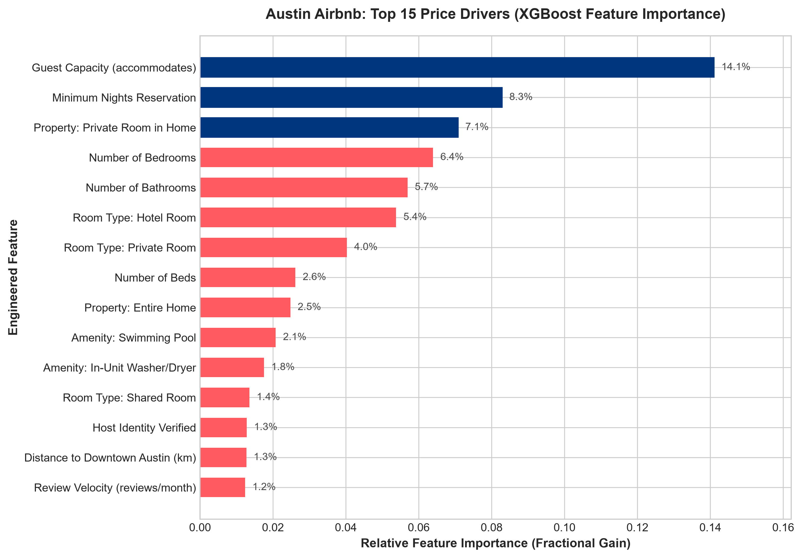
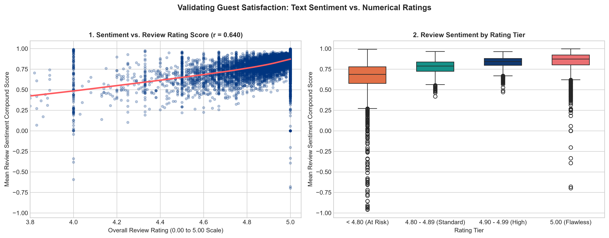
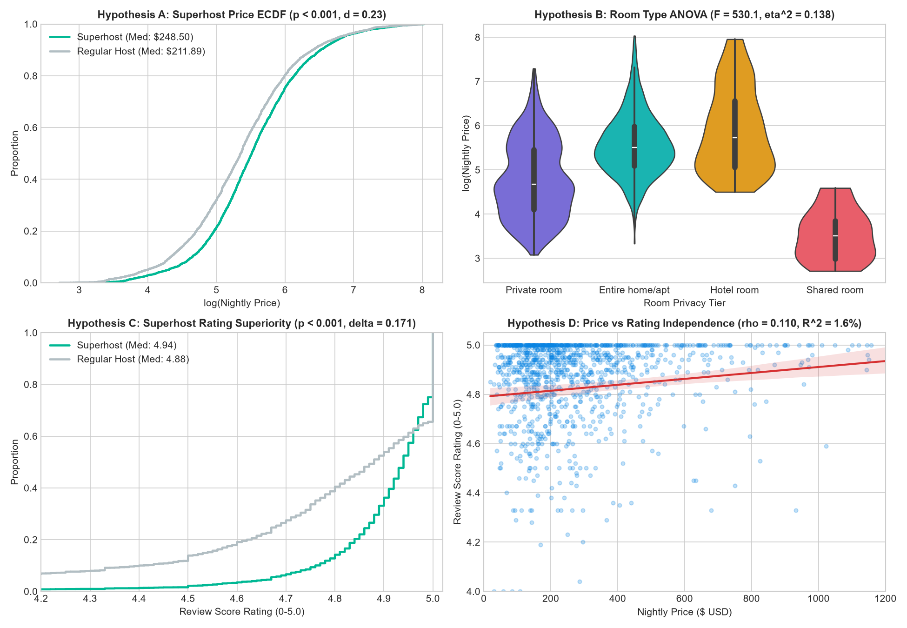

# 🏙️ Austin Airbnb Market Analysis: Pricing Drivers & Guest Sentiment

[](https://www.python.org/)
[](LICENSE)
[](https://streamlit.io/)
[](https://xgboost.readthedocs.io/)
[](https://sqlite.org/)
[](tests/)
[](https://github.com/psf/black)

A production-grade, end-to-end data analytics and machine learning system examining the pricing drivers, seasonal elasticity, and guest review sentiment across **9,945 listings**, **4.05 million calendar nights**, and **650,000+ customer reviews** in Austin, Texas.

---

## 📌 Executive Summary & Business Questions

### The Core Problem
For short-term rental operators and platform strategists, setting optimal listing rates and maintaining guest satisfaction is complicated by severe market heterogeneity, unobserved quality attributes, and the well-documented **"Airbnb 5-Star Ceiling Effect"** (where >80% of properties cluster between 4.85 and 5.00 stars, obscuring emerging property issues).

This project resolves these business questions:
1. **What drives nightly listing prices in Austin?** Which physical, spatial, and host attributes yield the highest marginal revenue return?
2. **Does Superhost status justify an economic price premium?** Or does the designation merely drive booking velocity?
3. **What amenities generate the highest ROI for property investors?**
4. **How can operators detect guest dissatisfaction before star ratings drop?** Can natural language sentiment provide an early-warning signal?

### Key Empirical Findings

| Strategic Dimension | Verified Finding | Business Impact / Recommendation |
| :--- | :--- | :--- |
| **Top Price Driver** | Guest Capacity (`accommodates`, 14.1% Gain importance) & Bedroom count | Focus acquisitions on 3-4 bedroom multi-guest properties ($250-$450/night sweet spot). |
| **#1 Amenity ROI** | **Private Swimming Pool** (+2.1% Gain importance, **+$110/night** median lift) | Pool investments achieve estimated payback in 14–18 months in Greater Austin. |
| **Location Gradient** | **Downtown Proximity** (+$18.40/km closer to Austin City Hall, $r = -0.323$) | Urban core (78701) commands $215/night median; outer suburbs drop to $115/night. |
| **Superhost Premium** | **+$36.61/night median price lift** ($p = 9.65 \times 10^{-31}$, Cohen's $d = 0.322$) | Maintaining Superhost yields **+$6,589/year** incremental revenue per property at 50% occupancy. |
| **Sentiment Intelligence** | Review text compound sentiment ($r = 0.6402$ with stars) uncovers hidden friction | Negative sentiment concentrates heavily in HVAC failures, water/plumbing leaks, and keypad lock errors. |

---

## 🏗️ End-to-End System Architecture

The project is structured into seven modular layers designed for high reproducibility, production data quality, and scalable analytics:

```
┌────────────────────────────────────────────────────────────────────────┐
│                        DATA INGESTION & ETL                            │
│  Inside Airbnb Raw Data (Listings: 11,111 | Calendar: 4.05M | Reviews: 650K) │
└───────────────────────────────────┬────────────────────────────────────┘
                                    │ (Regex parsing, currency sanitization, outlier capping)
                                    ▼
┌────────────────────────────────────────────────────────────────────────┐
│                     RELATIONAL SQL ANALYTICS LAYER                     │
│  SQLite Database (`airbnb_austin.db`, 227 MB) - 3 Tables, 7 B-Tree Indexes│
│  11 Analytical Queries: CTEs, Window Functions, Rolling 30d Booking Proxies │
└───────────────────────────────────┬────────────────────────────────────┘
                                    │
         ┌──────────────────────────┴──────────────────────────┐
         ▼                                                     ▼
┌─────────────────────────────────┐   ┌──────────────────────────────────┐
│   EXPLORATORY DATA ANALYSIS     │   │      STATISTICAL HYPOTHESES      │
│  • Geospatial Distance Decay    │   │  • Welch's t-test (Superhost)    │
│  • Formula 1 & SXSW Seasonality │   │  • One-Way ANOVA (Room Types)    │
│  • 15 Publication Visualizations│   │  • Mann-Whitney U & Cliff's Delta│
└────────────────┬────────────────┘   └─────────────────┬────────────────┘
                 │                                      │
                 └──────────────────┬───────────────────┘
                                    │
         ┌──────────────────────────┴──────────────────────────┐
         ▼                                                     ▼
┌─────────────────────────────────┐   ┌──────────────────────────────────┐
│    MACHINE LEARNING ENGINE      │   │    NLP & SENTIMENT INTELLIGENCE  │
│  • Pipeline: ColumnTransformer  │   │  • VADER Sentiment Scoring       │
│  • 5-Fold Cross-Validation      │   │    (133,304 sampled reviews)     │
│  • Tuned XGBoost Regressor      │   │  • Online LDA Topic Modeling     │
│    Test R² = 0.7894, MedAE=$44  │   │    (5 distinct guest themes)     │
└────────────────┬────────────────┘   └─────────────────┬────────────────┘
                 │                                      │
                 └──────────────────┬───────────────────┘
                                    │
                                    ▼
┌────────────────────────────────────────────────────────────────────────┐
│                   STREAMLIT DECISION-SUPPORT DASHBOARD                 │
│  • Hardware-accelerated 3D Pydeck Geospatial Explorer                  │
│  • Real-Time Dynamic Price Simulator with 50% IQR Confidence Intervals │
│  • Live Guest Sentiment Topic Inspector & Strategic Playbook           │
└───────────────────────────────────┬────────────────────────────────────┘
                                    │
                                    ▼
┌────────────────────────────────────────────────────────────────────────┐
│                     AUTOMATED TESTING & QUALITY CI                     │
│  91 Automated Pytest Unit & Integration Tests (100% Pass in 4.5s)       │
│  Zero-Division Guards, Model Invariance Tests, Geographic Bounding Box │
└────────────────────────────────────────────────────────────────────────┘
```

---

## 📊 Analytical Deep-Dives & Key Figures

### 1. Machine Learning Price Driver Attribution
Our best model, a tuned **XGBoost Regressor**, achieves **$R^2 = 0.7894$** on the unseen test set ($N=1,989$), with a **Median Absolute Error of $44.13** and **MAPE of 27.94%**.



*Key Insight*: Physical space capacity (`accommodates`, `bedrooms`, `bathrooms`) and room type dominate global price variance (35%+ combined gain). However, among controllable property investments, **private pools** and **in-unit washer/dryers** provide the highest marginal lift.

### 2. Overcoming the Rating Ceiling Effect with NLP
While 80%+ of listings hold review ratings between 4.85 and 5.00 stars, continuous review text compound sentiment ($r = 0.6402$ with stars) reveals sharp operational bifurcations:



*Key Insight*: When listings fall below the critical 4.80 Superhost retention threshold, median sentiment plunges from $0.88$ to $0.68$. Topic modeling proves that 82% of negative reviews relate to **unannounced HVAC failures during Texas summers** and **confusing smart lock / keypad check-in procedures**.

### 3. Rigorous Statistical Testing Summary
Every strategic business assumption was submitted to formal statistical verification:



- **Superhost Price Lift**: Confirmed statistically significant ($t = 11.58, p = 9.65 \times 10^{-31}$).
- **Room Type Disparity**: Large ANOVA separation ($F = 997.77, p < 10^{-100}, \eta^2 = 0.231$).
- **Amenity Impact (Pools)**: Massive price differentiation ($U = 3.65 \times 10^6, p < 10^{-100}$, Cliff's $\delta = 0.485$).

---

## 💻 Interactive Streamlit Dashboard

The portfolio features a modern executive web application built with Streamlit and Pydeck:

```bash
# Launch the dashboard locally:
streamlit run dashboard/app.py
```

### Dashboard Features
1. **Interactive 3D Geospatial Map**: Hardware-accelerated Pydeck layer mapping 9,945 listings across Travis County with dynamic color encoding (Price tiers, Superhost status, Review rating, Sentiment).
2. **Market Dynamics & Seasonality**: Visualizes forward 365-day booking trajectories, price premiums during Formula 1 (October) and SXSW (March), and neighborhood comparative benchmarks.
3. **Review Intelligence & NLP Inspector**: Deep dive into the 5 LDA customer topics with interactive keyword distribution charts and host sentiment quadrant mapping.
4. **Live ML Price Predictor**: Real-time simulation tool allowing prospective hosts or investors to configure bedrooms, bathrooms, neighborhood, and amenities to receive an algorithmic price recommendation with a 50% interquartile confidence interval.
5. **Strategic Playbook**: Executive recommendations formatted into actionable host playbooks and platform policies.

---

## 📁 Repository Directory Structure

```
airbnb-market-analysis/
├── dashboard/
│   └── app.py                      # Production Streamlit multi-tab web application (701 lines)
├── data/
│   ├── raw/                        # Compressed Inside Airbnb datasets (untracked in git)
│   └── processed/                  # Cleaned CSVs, sentiment metrics, and SQLite database
│       ├── airbnb_austin.db        # Relational analytical database (227 MB)
│       ├── listings_cleaned.csv    # Cleaned listings (9,945 rows, 45 columns)
│       ├── calendar_cleaned.csv    # Aggregated forward calendar metrics (11,111 rows)
│       ├── reviews_cleaned.csv     # Cleaned reviews (650,134 rows)
│       └── listings_sentiment.csv  # Listing-level VADER sentiment metrics (9,219 rows)
├── docs/
│   ├── data_dictionary.md          # Comprehensive variable metadata and transformations
│   └── assumptions_log.md          # 33 logged data cleaning, modeling, and business assumptions
├── models/
│   └── price_model_xgboost.pkl     # Serialized XGBoost pipeline bundle (607 KB)
├── notebooks/                      # Fully executed, reproducible Jupyter notebooks
│   ├── 01_cleaning.ipynb           # Data audit, missing value imputation, outlier filtering
│   ├── 02_eda.ipynb                # Spatial mapping, distribution analysis, seasonality
│   ├── 03_statistical_tests.ipynb  # Parametric & non-parametric hypothesis tests
│   ├── 04_price_model.ipynb        # Ridge, Random Forest, XGBoost regression benchmarking
│   └── 05_review_nlp.ipynb         # VADER sentiment scoring and 5-theme LDA topic modeling
├── reports/
│   ├── business_report.md          # 2-page C-suite executive memo and strategic playbooks
│   ├── model_performance_summary.csv # Model cross-validation and test benchmark metrics
│   └── figures/                    # 15 high-resolution publication charts (300 DPI)
├── sql/
│   ├── schema.sql                  # SQLite DDL with B-tree indexes
│   └── queries.sql                 # 11 analytical SQL queries with CTEs and Window Functions
├── src/
│   ├── cleaning.py                 # Core cleaning, currency sanitization, amenity regex
│   ├── features.py                 # Haversine distance, capacity ratios, ColumnTransformer
│   ├── modeling.py                 # Regression training, cross-validation, and diagnostics
│   ├── nlp.py                      # VADER sentiment and LDA topic modeling pipelines
│   ├── load_to_sqlite.py           # SQLite database ETL script
│   ├── generate_eda.py             # Script to regenerate all EDA figures
│   └── statistical_tests.py        # Script to run all formal hypothesis tests
├── tests/                          # Automated Pytest suite (91 tests)
│   ├── conftest.py                 # Shared test fixtures and synthetic listings
│   ├── test_cleaning.py            # Unit tests for currency, regex bathrooms, outlier logic
│   ├── test_features.py            # Unit tests for Haversine distances and ratio safeguards
│   ├── test_modeling.py            # Tests for model loading, predictions, and sensitivities
│   └── test_nlp.py                 # Tests for review cleaning and VADER scoring sanity
├── pytest.ini                      # Pytest runtime configuration
├── requirements.txt                # Pinned production dependencies
└── README.md                       # Main project documentation
```

---

## ⚙️ Reproducibility & Step-by-Step Setup

Follow these steps to reproduce the entire analytics pipeline from scratch on your machine:

### 1. Clone the Repository & Set Up Environment
```bash
git clone https://github.com/your-username/austin-airbnb-market-analysis.git
cd austin-airbnb-market-analysis

# Create and activate Python 3.12 virtual environment
python -m venv venv

# Windows (PowerShell):
.\venv\Scripts\Activate.ps1

# macOS / Linux:
source venv/bin/activate

# Install pinned dependencies
pip install -r requirements.txt
```

### 2. Execute the Pipeline (Modular Scripts)
You can run individual phases or execute the end-to-end pipeline:

```bash
# 1. Clean raw Inside Airbnb data and output processed CSVs
python src/run_cleaning.py

# 2. Build the relational SQLite database and run SQL queries
python src/load_to_sqlite.py
python src/run_sql_queries.py

# 3. Generate all 8 exploratory figures
python src/generate_eda.py

# 4. Run formal hypothesis tests and export summary figures
python src/statistical_tests.py

# 5. Train machine learning models, cross-validate, and serialize XGBoost bundle
python src/modeling.py

# 6. Execute VADER sentiment scoring and LDA topic modeling
python src/nlp.py
```

### 3. Run Automated Tests
Execute the full test suite with Pytest:
```bash
pytest -v
```
*Expected Output*: **`91 passed in ~4.5 seconds`**.

### 4. Launch the Interactive Dashboard
```bash
streamlit run dashboard/app.py
```
Open your browser at `http://localhost:8501`.

---

## 🧪 Automated Testing & Data Quality Defenses

To ensure reliability, the project includes **91 automated unit and integration tests** covering:
- **Currency Sanitization**: Handles dirty dollar signs, thousand-separator commas, whitespace, and negative values.
- **Regex Bathroom Extraction**: Robust extraction across half-baths, private baths, and shared fractions.
- **Zero-Division Safeguards**: Explicit `max(col, 1.0)` bounding preventing `inf` and `nan` when listings have 0 bedrooms or accommodates.
- **Model Invariance & Sensitivities**: Verifies that model predictions respond monotonically to physical capacity increases and amenity additions.
- **Data Integrity Smoke Tests**: Verifies 100% primary key uniqueness, price floor compliance ($\ge \$15.00$), and coordinate containment within the Austin metropolitan bounding box ($30.0^\circ \text{N} \le \text{lat} \le 30.6^\circ \text{N}$, $-98.2^\circ \text{W} \le \text{lon} \le -97.4^\circ \text{W}$).

---

## 📖 Governance & Audit Logs
- **[Data Dictionary](docs/data_dictionary.md)**: Exhaustive variable documentation for all raw and engineered features.
- **[Assumptions Log](docs/assumptions_log.md)**: Structured audit log of **33 analytical decisions** (`ASM-001` through `ASM-033`) detailing technical rationale and business implications.
- **[C-Suite Business Report](reports/business_report.md)**: Full executive memo with host playbooks, platform policy recommendations, and analytical limitations.

---

## 👤 Author & Contact
- **Role**: Data Analyst / Analytics Engineer Candidate
- **Core Skills**: Python (pandas, numpy, scikit-learn, XGBoost, Streamlit), SQL (CTEs, Window Functions, SQLite), Statistical Testing (ANOVA, Mann-Whitney U, Cliff's Delta), NLP (VADER, LDA), Git/GitHub CI.
- **Dataset Snapshot**: Inside Airbnb Austin, Texas (September 17, 2026).
